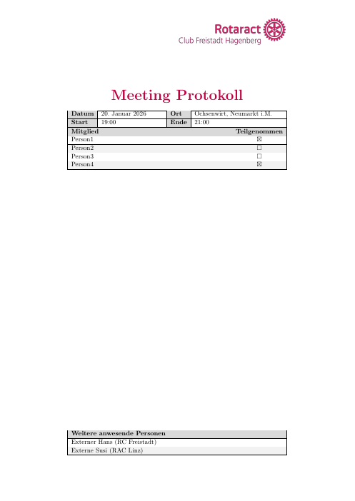
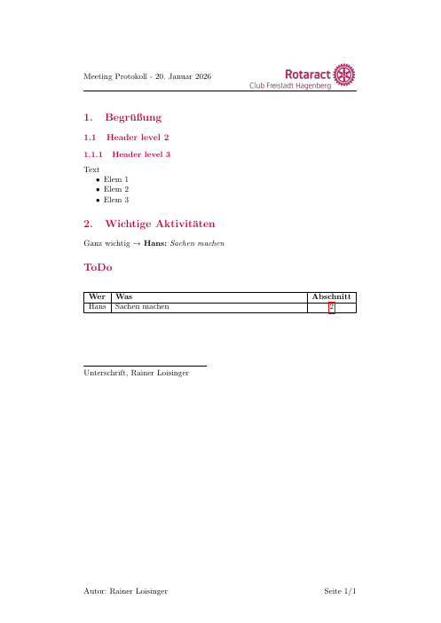

# Rotaract Club Freistadt-Hagenberg

Template for Rotaract Meeting Protocol using LaTeX.

## Getting Started

Each meeting lives in its own folder (named `YYYYMMDD`) and references the shared `template` folder through a symlink (`ln -s ../template template`). This avoids copying the template into every project.

### Recommended tech stack

* vscode with the `LaTeX Workshop` plugin from James Yu
* TeX Live (`texlive texlive-latex-extra texlive-lang-german` on Ubuntu, `texlive` packages on Arch)
* `latexmk` for building

## Usage

Create a new meeting (copies the example, sets the date, creates the symlink):

```sh
./new-meeting.sh 20260301
```

Then edit `meeting.tex`, `member-attendance.csv` and `external-visitors.csv` and build with `make` (or `latexmk -pdf meeting.tex` inside the folder).

* Dates are ISO (`\mDate{2026-01-20}`) and printed as `20.01.2026`.
* Attendance values `1`, `x` and `ja` count as present.
* `\todo[deadline]{Who}{What}` records a todo, `\printtodos{}` prints the summary.
* Labels (`Seite`, `Autor`, ...) are macros at the top of `template/rac-meeting.cls`.

See the example [meeting.tex](./20260120/meeting.tex).

## Example



